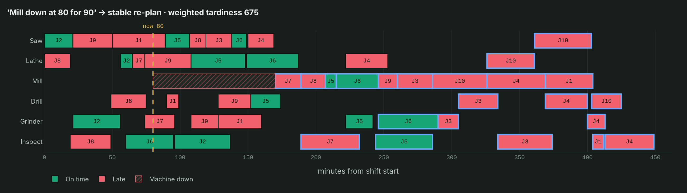
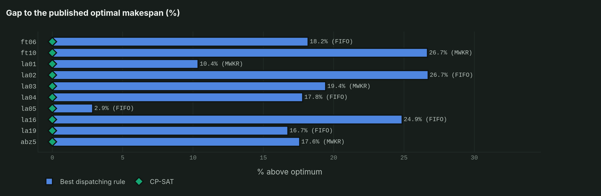
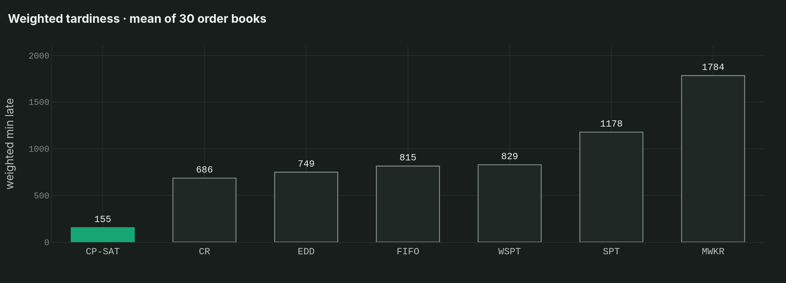
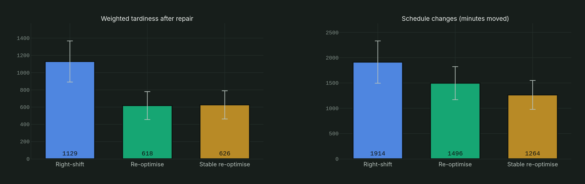
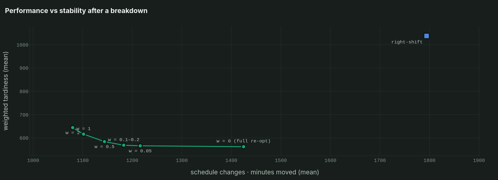

# Production Scheduling Copilot

**Tell the planner what happened on the shop floor in plain words. An optimisation solver builds the new plan, a checker verifies it, and the copilot explains what changed.**



> ⚠️ **The order books are simulated** (10 jobs × 6 machines, illustrative times and due dates). The classic benchmark instances are public and are downloaded on demand, not stored in this repo.

---

## The problem

Every machine shop runs on a schedule, and every schedule breaks: a machine fails, a customer calls with a rush order, a new job arrives. Two things make re-planning hard:

- **Rules of thumb are fast but far from optimal.** Shop-floor systems usually build plans with dispatching rules (first-in-first-out, earliest due date…). On the 30 simulated order books here, the best rule left jobs **4.4× later** than the optimal plan.
- **Optimisers are powerful but hard to talk to.** Planners do not write constraint models. They say *"the mill is down until ten"*.

Industry analysts expect AI agents to take over more and more planning decisions, with human planners still supervising them for years to come. This project builds that pattern on a small scale and keeps it honest: **the language layer only chooses the action. The schedule always comes from operations research and is always checked.**

## How it works

```
"Mill down at 80 for 90"
        │
        ▼
 1. Understand ─ rule-based parser (offline)  or  optional LLM (OpenAI-compatible API)
        │        → {"action": "breakdown", "machine": 2, "start": 80, "duration": 90}
        ▼
 2. Validate   ─ machine / job exist? times sensible?  (bad actions are rejected)
        ▼
 3. Decide     ─ OR-Tools CP-SAT re-plans from "now"; started work is frozen;
        │        optional penalty on moving operations (plan stability)
        ▼
 4. Verify     ─ independent checker: precedence, machine overlap, downtime, release times
        ▼
 5. Explain    ─ weighted tardiness 83 → 675 · late jobs 2 → 7 · 23 operations moved · bottleneck: Inspect
```

## Features

- **Job-shop model** with routes, release times, due dates, priorities (weights) and machine downtime.
- **Six dispatching rules** (FIFO, SPT, EDD, MWKR, CR, WSPT) inside the Giffler–Thompson active-schedule generator.
- **OR-Tools CP-SAT model** for makespan or total weighted tardiness, **validated on 10 classic benchmarks** (all solved to the published optimum).
- **Three repair strategies** after a disruption: right-shift, full re-optimisation, and stable re-optimisation (penalises moving operations).
- **Copilot commands:** breakdowns (`Mill down at 80 for 90`, `Lathe broken from 2h to 3h`), rush orders (`rush J4 due 200`), due-date changes, new jobs (`new job Saw 20, Lathe 25, Inspect 10 due 300 weight 3`), objective and method switches, `compare rules`, `explain`, `undo`, `reset`.
- **Optional LLM parser** through any OpenAI-compatible endpoint (e.g. Gemini's free tier, Groq, a local Ollama). The app works fully without it.
- **Streamlit app** in the MH Emerald & Gold style: interactive Gantt chart, chat, quick commands, rule comparison, study results, plan export to CSV.

## Results

### 1 · The solver is right: 10 of 10 benchmarks solved to the known optimum

| | ft06 | ft10 | la01 | la02 | la03 | la04 | la05 | la16 | la19 | abz5 |
|---|---|---|---|---|---|---|---|---|---|---|
| Published optimum | 55 | 930 | 666 | 655 | 597 | 590 | 593 | 945 | 842 | 1234 |
| CP-SAT (≤ 60 s) | **55** | **930** | **666** | **655** | **597** | **590** | **593** | **945** | **842** | **1234** |
| Best dispatching rule, % above optimum | 18.2 | 26.7 | 10.4 | 26.7 | 19.4 | 17.8 | 2.9 | 24.9 | 16.7 | 17.6 |



### 2 · Rules vs optimal on 30 simulated order books

| Objective | CP-SAT | Best rule | Improvement |
|---|---|---|---|
| Weighted tardiness (mean) | **155** | 686 (CR) | **−77%** |
| Makespan (mean, min) | **329** | 393 (FIFO) | **−16%** |

CP-SAT proved optimality on all 30 order books for makespan and on 27 of 30 for weighted tardiness. The other 3 reached the 10-second limit, so the result shown is the best plan found. Which rule is "best" depends on the objective: CR for due dates, FIFO for makespan.



### 3 · After a breakdown: repair or re-plan?

30 scenarios. In each one a random machine fails for 60, 90 or 120 min at a random moment (20 to 50% into the plan). Every method gets the same 30 scenarios.

| Method | Weighted tardiness | Late jobs | Minutes moved |
|---|---|---|---|
| Right-shift (keep sequences) | 1129 | 7.1 | 1914 |
| Full re-optimisation | **618** | **5.5** | 1496 |
| Stable re-optimisation (w = 0.2) | 626 | 5.7 | **1264** |

- **Re-planning beats repairing:** −511 ± 131 weighted tardiness vs right-shift (paired 95% CI).
- **Stability is almost free:** compared with full re-optimisation, the move penalty costs only +8 ± 5 weighted tardiness and cuts schedule changes by 232 ± 86 minutes (−16%).
- **Surprise:** right-shift keeps every machine's sequence but moves the *most* minutes, because each delay cascades down the line. "Don't touch the plan" does not mean "small changes".




### Limitations (please read)

- **Simulated data.** Order books, processing times, due dates and weights are illustrative, so the size of the gains will differ in a real shop.
- **Deterministic shop.** Processing times and repair durations are known exactly once announced. There is no stochastic re-planning, no setup times, and no alternative machines (classic job shop, not flexible job shop).
- **LLM path:** tested with a *mocked* endpoint only (the parsing, validation and fall-back logic are unit-tested). It was not tested against a live model in this build. The built-in parser understands a fixed English grammar.
- **Stability** is measured as total minutes moved. Other nervousness measures exist (sequence changes, operations moved across shifts).
- CP-SAT with several workers can return a different optimal plan of equal quality from run to run.

## Getting started

```bash
git clone https://github.com/Muat01/production-scheduling-copilot.git
cd production-scheduling-copilot
python -m venv .venv
.venv\Scripts\activate            # Windows  (macOS/Linux: source .venv/bin/activate)
pip install -r requirements.txt

streamlit run app.py              # the copilot app
python -m pytest                  # 46 tests (model, rules, solver, rescheduling, parser, app)
python experiments.py             # re-run the full study (~15 min) -> results/
python make_docs.py               # re-export README figures (needs kaleido)
```

**Optional LLM parser:** set three environment variables (or Streamlit secrets) and switch on *Use an LLM* in the sidebar:

```bash
set LLM_API_KEY=your-key
set LLM_BASE_URL=https://generativelanguage.googleapis.com/v1beta/openai/
set LLM_MODEL=gemini-2.5-flash    # check your provider's current model names
```

Use from Python:

```python
from jobshop import make_shop
from copilot import Copilot
cp = Copilot(make_shop(1), now=60)
print(cp.handle("Mill down at 80 for 90")["message"])
```

## Data availability

- **Order books:** generated by `jobshop.make_shop(seed)`. Due dates follow the total-work-content (TWK) rule (Baker, 1984). Seeds 1 to 30 reproduce the study.
- **Benchmarks:** ft06 is included (Fisher & Thompson, 1963). The others are downloaded on demand from [JSPLIB](https://github.com/tamy0612/JSPLIB) by `benchmarks.py` and are not redistributed here.
- **Results:** `results/*.csv` are the outputs of `python experiments.py`.

## Project structure

```
production-scheduling-copilot/
├── app.py            # Streamlit app (copilot, rules vs optimal, study, method)
├── jobshop.py        # data model, simulated order books, feasibility checker, KPIs
├── rules.py          # dispatching rules + Giffler–Thompson active schedules
├── solver.py         # OR-Tools CP-SAT model (makespan / weighted tardiness, freezing, stability)
├── reschedule.py     # disruption events and repair strategies
├── copilot.py        # parser (rules / optional LLM), validation, explanations, session
├── benchmarks.py     # classic instances, downloaded on demand
├── experiments.py    # the study behind the results
├── charts.py · ui.py · theme.py   # MH Emerald & Gold visuals
├── make_docs.py      # README figures
├── results/ · docs/ · tests/
├── .streamlit/config.toml · requirements.txt · LICENSE
```

## Possible extensions

- Flexible job shop (alternative machines) and sequence-dependent setup times.
- Stochastic repair times and robust schedules (slack where breakdowns are likely), linked to the [asset health digital twin](https://github.com/Muat01/asset-health-digital-twin).
- Rolling-horizon re-planning that triggers itself on events from a machine data stream.
- Evaluate several LLMs on a benchmark of planner commands (accuracy of the parsed actions).

## References

1. Giffler, B., & Thompson, G. L. (1960). Algorithms for solving production-scheduling problems. *Operations Research*, 8(4), 487–503. https://doi.org/10.1287/opre.8.4.487
2. Panwalkar, S. S., & Iskander, W. (1977). A survey of scheduling rules. *Operations Research*, 25(1), 45–61. https://doi.org/10.1287/opre.25.1.45
3. Baker, K. R. (1984). Sequencing rules and due-date assignments in a job shop. *Management Science*, 30(9), 1093–1104. https://doi.org/10.1287/mnsc.30.9.1093
4. Vieira, G. E., Herrmann, J. W., & Lin, E. (2003). Rescheduling manufacturing systems: A framework of strategies, policies, and methods. *Journal of Scheduling*, 6(1), 39–62. https://doi.org/10.1023/A:1022235519958
5. Ouelhadj, D., & Petrovic, S. (2009). A survey of dynamic scheduling in manufacturing systems. *Journal of Scheduling*, 12(4), 417–431. https://doi.org/10.1007/s10951-008-0090-8
6. Zhang, L., et al. (2026). DScheLLM: Enabling dynamic scheduling through a fine-tuned dual-system large language model. arXiv:2601.09100. https://arxiv.org/abs/2601.09100
7. Yan, J., & Ji, S. (2026). Industrial mechanism-aware multi-agent collaboration of large language models for job shop scheduling optimization. *Computers & Industrial Engineering*, 217, 112079.
8. Perron, L., & Didier, F. CP-SAT, Google OR-Tools (v9.15). https://developers.google.com/optimization
9. Benchmark instances: Fisher, H., & Thompson, G. L. (1963) in Muth, J. F., & Thompson, G. L. (Eds.), *Industrial Scheduling*, Prentice-Hall; Lawrence, S. (1984), Carnegie-Mellon University; Adams, J., Balas, E., & Zawack, D. (1988), *Management Science*, 34(3), 391–401. Collected in JSPLIB.
10. Industry context: Gartner, *Top Supply Chain Technology Trends for 2026* (agentic AI) and its forecast that human planners will stay involved in most planning decisions through 2030, as reported by [Supply Chain Digital](https://supplychaindigital.com/news/gartner-how-autonomous-tools-are-reshaping-supply-chains) and [SupplyChain247](https://www.supplychain247.com/article/gartner-autonomous-supply-chain-planning-2030/451_research).

## Author

**Muatasem Hadi** · MEng Industrial Engineering, Telkom University, Bandung
[LinkedIn](https://www.linkedin.com/in/muatasem-hadi) · [GitHub](https://github.com/Muat01)

Licensed under the MIT License.
